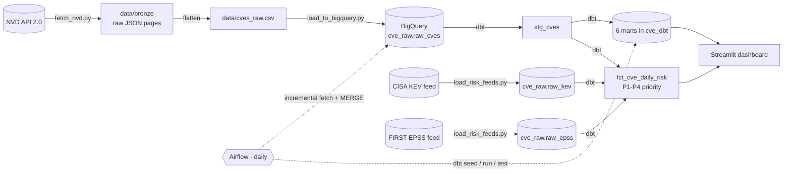

# CVE Threat Intelligence Pipeline

A data pipeline that collects security vulnerabilities (CVEs) from NIST's official **NVD** database and answers five questions on an interactive dashboard:

1. Which **vendors** are most affected, and how severe are their vulnerabilities?
2. How do **severity trends** change over time?
3. Which **weakness types (CWE)** keep coming back, and how is that mix shifting year to year?
4. How is the threat landscape shifting toward **AI / LLM systems**, and how do these CVEs map to the **OWASP Top 10 for LLM Applications** and **MITRE ATLAS**?
5. Given real exploitation signals (**CISA KEV**, **FIRST EPSS**) and our own simulated asset exposure, which CVEs should be **patched first**?

Final project - Le Wagon Data Engineering bootcamp.

**Stack:** Python · NVD API 2.0 · CISA KEV · FIRST EPSS · Google BigQuery · dbt · Apache Airflow (Docker) · Streamlit

---

## 1. Architecture



| Layer | Where | What it holds |
|---|---|---|
| Bronze | `data/bronze/*.json` | Raw API pages, untouched (lets you re-process without re-calling NVD) |
| Raw | BigQuery `cve_raw.raw_cves` | One flat row per CVE (10 columns, see below) |
| Raw (risk feeds) | BigQuery `cve_raw.raw_kev`, `cve_raw.raw_epss` | CISA Known Exploited Vulnerabilities catalog, FIRST EPSS exploitation-probability scores |
| Staging | dbt view `stg_cves` | De-duplicated, cleaned, `is_ai_related` flag |
| Marts | dbt tables in `cve_dbt` | Analysis-ready tables the dashboard reads |
| Risk mart | dbt table `fct_cve_daily_risk` | Daily snapshot combining severity, KEV, EPSS and simulated asset exposure into a P1-P4 patch-priority tier |

### The data contract (columns of `raw_cves`)

`cve_id, published_date, last_modified_date, vuln_status, severity, cvss_score, vendor, product, cwe_id, description`

If you add a column, update it everywhere: `ingestion/fetch_nvd.py` (`COLUMNS`, `flatten_cve`) → `ingestion/load_to_bigquery.py` (`SCHEMA`) → `dbt_cve/models/staging/sources.yml` → `stg_cves.sql`.

### dbt marts

| Mart | Grain | Used for |
|---|---|---|
| `mart_severity_trends` | year × severity | severity over time |
| `mart_vendor_severity` | vendor × year | top vendors |
| `mart_cwe_trends` | year × CWE | most common weaknesses, and the trend-over-time view |
| `mart_ai_trends` | year | AI/LLM-related count and share |
| `mart_ai_cve_list` | CVE (latest 500) | detail table |
| `mart_owasp_atlas` | year × OWASP category × ATLAS technique | threat-framework mapping |
| `fct_cve_daily_risk` | snapshot day × CVE | patch-priority queue (P1-P4), combining CVSS severity, CISA KEV membership, FIRST EPSS score and simulated asset exposure |

---

## 2. Repository layout

```
├── ingestion/        fetch_nvd.py · load_to_bigquery.py · load_risk_feeds.py (KEV + EPSS) · config.py · generate_mock_data.py
├── dbt_cve/          models/{staging,marts} · seeds/cwe_owasp_atlas.csv · seeds/simulated_assets.csv · macros/ai_regex.sql · tests/
├── dags/             cve_pipeline_dag.py   (Airflow)
├── docker/           Dockerfile · docker-compose.yml · .env.sample
├── dashboard/        app.py · risk_queue.py (Patch Priority Queue tab) · build_sample_marts.py
├── data/sample/      small SYNTHETIC CSVs so the dashboard runs with no cloud
├── docs/             ARCHITECTURE.md
├── run_dbt.sh        runs dbt with the settings from .env
├── .env.example      copy to .env
└── requirements.txt
```

---

## 3. Quick demo (no cloud account, 2 minutes)

The CSVs in `data/sample/` are **synthetic** (generated, not real findings). They exist so the dashboard always runs, e.g. as a safety net before the presentation.

```bash
python -m venv venv-dashboard
source venv-dashboard/bin/activate        # Windows: venv-dashboard\Scripts\activate
pip install -r dashboard/requirements.txt
streamlit run dashboard/app.py
```

The caption at the top says **"Local sample data (synthetic)"**. Regenerate the samples any time with
`python ingestion/generate_mock_data.py` then `python dashboard/build_sample_marts.py`.

> The Patch Priority Queue tab requires live BigQuery data (section 4) - it shows an info message on sample data, since a priority queue on synthetic numbers wouldn't mean anything.

---

## 4. Full setup - real NVD data + BigQuery

### 4.1 Prerequisites
- Python 3.10+ and Git.
- A free **NVD API key**: <https://nvd.nist.gov/developers/request-an-api-key> (click the activation link in the email!).
- A Google Cloud project with BigQuery enabled, two datasets in the **same location** (e.g. `US`): `cve_raw` and `cve_dbt`.
- A **service account** with role *BigQuery Admin* (or *Data Editor* + *Job User*) and a JSON key downloaded.

### 4.2 Configure
```bash
cp .env.example .env        # then edit it: NVD key, project ID, key path
python -m venv venv
source venv/bin/activate    # Windows: venv\Scripts\activate
pip install -r requirements.txt
```
Put the key file in the repo root (e.g. `gcp-key.json`) or in `keys/`, and set `GOOGLE_APPLICATION_CREDENTIALS` in `.env` to its path. Both are gitignored.

### 4.3 Load the history (run once)
```bash
python ingestion/fetch_nvd.py --start-year 2023     # downloads to data/bronze, then writes data/cves_raw.csv
python ingestion/load_to_bigquery.py --mode replace  # creates cve_raw.raw_cves
```
- The download resumes where it stopped if interrupted - just run the same command again.
- Already have JSON files in `data/bronze`? Skip the download: `python ingestion/fetch_nvd.py --flatten-only --start-year 2023`.
- Row counts depend on the start year (about 199k CVEs from 2023, 168k from 2024, 127k from 2025 as of October 2026).

### 4.4 Load risk-enrichment feeds (KEV + EPSS, run once)
These feed the Patch Priority Queue (`fct_cve_daily_risk`). Download the two source files, then load them:
```bash
curl -o /tmp/cve-kev.json  https://www.cisa.gov/sites/default/files/feeds/known_exploited_vulnerabilities.json
curl -o /tmp/cve-epss.csv.gz https://epss.cyentia.com/epss_scores-current.csv.gz
python ingestion/load_risk_feeds.py           # creates cve_raw.raw_kev and cve_raw.raw_epss
```
- The script uses an append-only load (`WRITE_EMPTY`), so it only works the first time against an empty table. To refresh with a newer feed later, drop `raw_kev`/`raw_epss` in BigQuery first (or extend the script with a `--mode replace` option, same pattern as `load_to_bigquery.py`).
- EPSS scores change daily; KEV is updated as CISA adds newly exploited CVEs. For this project both are loaded once as a snapshot - see section 7 for making this incremental.

### 4.5 Transform with dbt
```bash
./run_dbt.sh deps     # installs dbt_utils (once)
./run_dbt.sh seed     # loads the CWE -> OWASP/ATLAS mapping and the simulated asset inventory
./run_dbt.sh run      # builds stg_cves + 6 marts + fct_cve_daily_risk in cve_dbt
./run_dbt.sh test     # data-quality checks
```

### 4.6 Dashboard on live data
Make sure `.env` has `GCP_PROJECT_ID`, then:
```bash
streamlit run dashboard/app.py
```
The caption changes to **"BigQuery (live)"**. If BigQuery fails, the app shows a warning and falls back to the synthetic sample. The Patch Priority Queue tab becomes available once `fct_cve_daily_risk` exists (section 4.4-4.5).

> Tip: install the dashboard in its own virtualenv (`venv-dashboard`), as in section 3, to avoid package conflicts with dbt.

### 4.7 Automate with Airflow (daily incremental)
```bash
cd docker
cp .env.sample .env                                  # set GCP_PROJECT_ID (+ NVD_API_KEY)
mkdir -p ../keys && cp /path/to/key.json ../keys/service-account.json
chmod 644 ../keys/service-account.json               # the container user must be able to read it
docker compose build                                 # first time, ~3-5 min (installs dbt)
docker compose up airflow-init                       # first time only
docker compose up -d
```
Open <http://localhost:8080> (user `airflow`, password `airflow`), switch the **`cve_pipeline_batch`** DAG on, or press *Trigger DAG*.

Each run: fetch CVEs created/modified in the last 3 days → **MERGE** into `raw_cves` (no duplicates) → `dbt seed` → `dbt run` (rebuilds marts and `fct_cve_daily_risk`) → `dbt test`. Run sections 4.3 and 4.4 first so the raw tables already hold data. `max_active_runs=1` on the DAG prevents overlapping runs if a trigger is late.

---

## 5. Design decisions and limitations (good to mention in the presentation)

- **Unscored CVEs are kept.** NVD has a large scoring backlog, so many recent CVEs have no CVSS score yet. Dropping them would make 2024-2026 look milder than reality, so they appear as `UNSCORED`.
- **Vendor = first CPE entry.** Simple and good enough for ranking, but a CVE affecting several vendors is counted once, and CVEs without CPE data are `unknown` (excluded from the vendor chart).
- **"AI-related" is a keyword heuristic** on the description (`dbt_cve/macros/ai_regex.sql`). It is transparent and tunable, but not ground truth; expect some false positives and misses.
- **CWE → OWASP LLM / ATLAS mapping is an analytical choice** (`dbt_cve/seeds/cwe_owasp_atlas.csv`). It links the *weakness type* of a CVE to the closest framework category; it does not claim the CVE is an LLM attack. It only covers the CWEs relevant to that mapping, not every CWE - a weakness outside that scope shows its bare ID in the CWE tab rather than a name. Review and refine it against the official OWASP and MITRE ATLAS pages.
- **"Affects our assets" is simulated**, not a real inventory (`dbt_cve/seeds/simulated_assets.csv`). It stands in for the kind of asset-matching a real security team would do against their own CMDB.
- **Patch priority (P1-P4) is a transparent scoring rule, not a vendor risk score**: P1 = affects our (simulated) assets *and* (in KEV *or* EPSS ≥ 0.50); P2 = in KEV, *or* affects our assets with EPSS ≥ 0.10 *or* CVSS ≥ 9; P3 = EPSS ≥ 0.05 *or* CVSS ≥ 7; P4 = everything else. The exact thresholds are a judgment call, documented in `dbt_cve/models/marts/fct_cve_daily_risk.sql`.
- **The current year is partial**, so compare it with earlier years carefully.
- **Rejected CVEs** are removed in staging.

---

## 6. Troubleshooting

| Symptom | Likely cause | Fix |
|---|---|---|
| Fetch is very slow | No `NVD_API_KEY` | Add the key to `.env` (the script warns at startup) |
| `403`/`429` from NVD | Rate limit | The script retries automatically; wait or add an API key |
| `GCP_PROJECT_ID is not set` | Missing `.env` value | Edit `.env` (project **ID**, not the name) |
| `Dataset ... not found` / location error | Dataset in another location | Create `cve_raw` and `cve_dbt` in the same location as `BQ_LOCATION` |
| `403 Access Denied` in BigQuery | Service account lacks a role | Grant *BigQuery Admin* (or Data Editor + Job User) |
| `dbt: command not found` | venv not active | `source venv/bin/activate` and `pip install -r requirements.txt` |
| dbt "Env var required but not provided" | Not using the helper | Run dbt through `./run_dbt.sh ...` |
| Dashboard says "Local sample data" | `GCP_PROJECT_ID` missing, or BigQuery error | Read the yellow warning at the top of the page |
| `load_risk_feeds.py` → `FileNotFoundError: /tmp/cve-kev.json` (or `cve-epss.csv.gz`) | Feed not downloaded yet | Run the two `curl` commands in section 4.4 first |
| `load_risk_feeds.py` → table already exists / write error | `raw_kev`/`raw_epss` already loaded (`WRITE_EMPTY`) | Only needs to run once; drop the table in BigQuery first if you need to reload |
| Patch Priority Queue tab says "Risk Mart is not available yet" | `fct_cve_daily_risk` not built | Complete sections 4.4 and 4.5 (`load_risk_feeds.py`, then `./run_dbt.sh run`) |
| Airflow DAG fails at `load_to_bigquery` | Key not readable in container | `chmod 644 keys/service-account.json`, restart |
| Airflow DAG import error | Image not rebuilt | `docker compose build` then `docker compose up -d` |

---

## 7. Future extension

A real-time lane with Google Pub/Sub (publisher pushes new CVEs, a subscriber writes them to `raw_cves`) can sit next to the batch lane. It is **not implemented**; the batch pipeline above is complete on its own.

The KEV/EPSS load (section 4.4) is a one-time snapshot; a natural next step is to make it incremental like `raw_cves` (daily refresh via Airflow, with `MERGE` instead of `WRITE_EMPTY`), so the Patch Priority Queue reflects the latest exploitation signals automatically.
