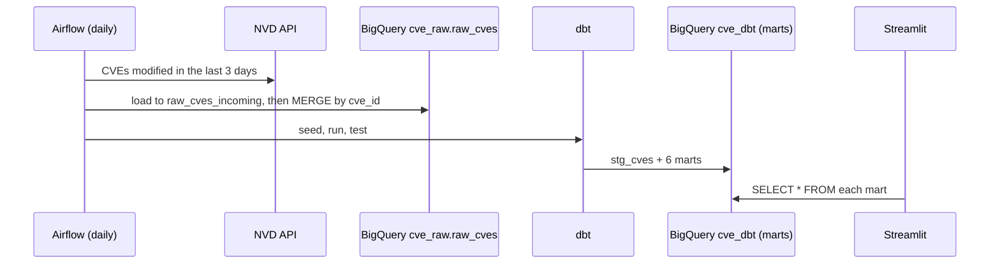

# Architecture notes

## Why these choices

- **Bronze files + flat CSV**: the slow, rate-limited step (calling NVD) is separated from loading, so a BigQuery failure never forces a re-download.
- **Flat raw table (10 columns)**: keeps dbt models simple; the complete JSON stays in `data/bronze` if more fields are needed later.
- **MERGE for incremental loads**: re-running a day, or overlapping the 3-day look-back, never creates duplicates.
- **dbt in its own virtualenv in the Airflow image**: avoids dependency conflicts between Airflow and dbt.
- **Marts at yearly grain**: the dashboard filters by year without querying the full CVE table.
